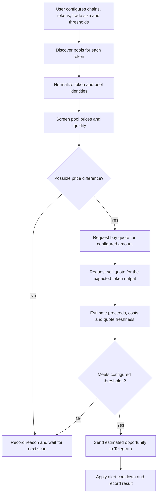

# DEX Arbitrage Monitor: Implementation Plan


Adding an independent monitoring feature to the existing Telegram trading bot (or create a seperate one). It will scan multiple tokens and decentralized exchanges (DEXs), compare potential buy and sell routes, and initially only alert you when the estimated return exceeds configurable thresholds.

The first version is **alert-only**. It will not sign or submit transactions. Its trade size is user-configurable; it does not require funding a wallet. Some quote services may require the existing wallet's public address.

Solana is a candidate for the first chain, followed by BNB and Robinhood Chain. The initial chain, DEXs, tho this remains to be chosen later.

## How monitoring works



1. The user chooses a chain, token addresses, venues, hypothetical trade size, and alert filters.
2. The scanner discovers supported pools and identifies each pool by chain, contract address, and its base and quote assets. It does not match tokens by symbol alone.
3. Indicative prices and liquidity narrow down possible candidates. These figures are screening data, not executable prices.
4. For each candidate, the scanner requests a buy quote for the selected amount and a sell quote for the exact expected output of that buy.
5. It estimates the return after costs, checks whether quotes are recent enough, and sends an alert if the configured thresholds are met.

The two quotes are snapshots, potentially from different moments. They do not prove that both legs can be executed together at those amounts. Pool data may be delayed, incomplete, or unavailable; a stale or unsupported candidate must be labelled or skipped.

## Example opportunity

The following numbers are illustrative:

```text
Token: EXAMPLE | Solana
Hypothetical amount: 100 USDC

Buy on DEX A: 1,000 EXAMPLE estimated
Sell on DEX B: 102 USDC estimated
Return before network and other additional costs: 2 USDC
Estimated additional costs: 0.20 USDC
Estimated net: 1.80 USDC
Quote age: 1.2 seconds
```

The estimate would use the amounts returned by each quote and deduct only costs not already reflected in those amounts. Gas, priority fees, approvals, token transfer taxes, wrapping, and other costs will be accounted for when applicable and known. Unknown costs will be shown as unknown rather than silently treated as zero. Slippage tolerance is a limit, not a guarantee of execution price.

## Provider strategy

| Chain | Candidate discovery | Trade-size quotes | Coverage to verify |
| --- | --- | --- | --- |
| Solana | DEX Screener and supported existing Pump data | Jupiter or venue-specific pool quoting | Verify current Jupiter V2 venue restrictions, pool coverage, and independently quotable routes. |
| BNB | DEX Screener | Supported PancakeSwap, Uniswap, and direct pool routes using existing infrastructure | Verify individual venue, pool, and token support. |
| Robinhood Chain | DEX Screener where pools are indexed | Supported Uniswap and existing direct routes | Verify which venues and pools can be independently quoted. |


## Suggested Telegram controls

Add an **Arbitrage monitor** menu with controls for:

- Enabling or disabling monitoring per chain.
- Adding or removing token addresses and viewing discovered pools.
- Selecting supported venues and setting a hypothetical trade size per chain or token.
- Setting minimum estimated net profit in USD and/or percentage.
- Setting minimum liquidity, maximum price impact, maximum quote age, and scan interval.
- Viewing recent opportunities, skipped candidates, and provider failures.
- Configuring alert cooldowns for repeated opportunities.

These settings are proposed functionality and do not exist until implemented. The monitor must coexist with the current channel-call trading, open-position tracking, and TP/SL operations.

