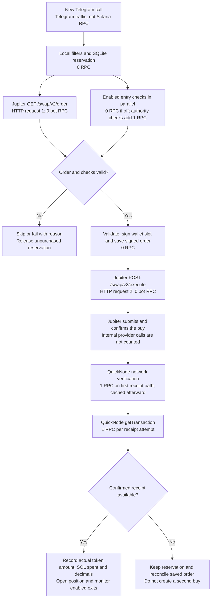

# Telegram Tracker Bot

A private Telegram bot that reads new calls from `SpyDefiLive`, filters callers and tokens, and trades from locally generated wallets. It supports Solana with SOL and Robinhood Chain with ETH. Ethereum-mainnet calls are skipped.

## What it does

- Reads the source channel through a logged-in Telegram user account. The control bot is separate and accepts commands only from the configured owner in a private chat.
- Extracts the contract address, token name, caller and Overall, Recent and Chain consistency. The chart link must identify a supported chain and match the contract address.
- Requires all three consistency rates to meet their independently configurable thresholds, initially 30%. Blocklisted callers are always skipped.
- Buys each token once per chain. Reposts by other callers do not create another purchase. A rejected call leaves the token available for a later qualifying caller.
- Supports configurable buy size, slippage, priority fee, market-cap range, optional token-safety checks, hard exits and trailing stages.
- Tracks confirmed holdings and entry spending in SOL or ETH. Displays an approximate USD value when available.
- Persists settings, calls, pending transactions and positions locally so restarts retain trading history.

There is one new-entry switch per chain. Enabling Solana enables eligible Solana buys; disabling it stops new Solana buys. Existing positions retain their configured automatic exits. There is no separate global Resume switch.

## Install and start

Requires Node.js 24 or newer. From the repository directory in PowerShell:

```powershell
npm.cmd ci
```

For a new installation, copy `.env.example` to `.env` and fill in the required values. Keep an existing `.env` when updating.

```powershell
npm.cmd run typecheck
npm.cmd run build
npm.cmd start
```

After source changes, rebuild before starting again. Stop the previous instance first. `npm.cmd run dev` runs the source through `tsx` for development.

The listener starts automatically with the app. On first Telegram-user login, the terminal requests the login code and any two-factor password. The account must have access to the source channel. The initial channel cursor starts at the latest post; historical channel messages are not replayed as new buy opportunities. Live updates are backed by a cursor-based poll every 10 seconds.

Open the control bot in Telegram and send `/start` or `/settings`.

## Credentials and environment

| Variable                               | Purpose                                                                                                                             |
| -------------------------------------- | ----------------------------------------------------------------------------------------------------------------------------------- |
| `TELEGRAM_API_ID`, `TELEGRAM_API_HASH` | Telegram user-client application credentials from [Telegram API development tools](https://core.telegram.org/api/obtaining_api_id). |
| `TELEGRAM_PHONE`                       | Phone number of the user account reading the source channel.                                                                        |
| `TELEGRAM_BOT_TOKEN`                   | Token for the separate control bot created through BotFather.                                                                       |
| `TELEGRAM_OWNER_ID`                    | Your numeric Telegram user ID, not your username. Only this account can control the bot.                                            |
| `TELEGRAM_SOURCE_CHANNEL`              | Source channel username, initially `SpyDefiLive`.                                                                                   |
| `QUICKNODE_SOLANA_RPC_URL`             | Solana mainnet RPC for receipts, reconciliation, balances and enabled on-chain safety checks.                                       |
| `JUPITER_API_KEY`                      | Jupiter order, execution, quote and optional token-data access.                                                                     |
| `QUICKNODE_ROBINHOOD_RPC_URL`          | Robinhood Chain RPC, chain ID 4663.                                                                                                 |
| `UNISWAP_API_KEY`                      | Robinhood swaps through Uniswap.                                                                                                    |
| `RUGCHECK_API_KEY`                     | Optional Rugcheck authentication.                                                                                                   |
| `GOPLUS_APP_KEY`, `GOPLUS_APP_SECRET`  | Matching GoPlus application credentials. The app obtains and refreshes access tokens automatically.                                 |
| `GOPLUS_ACCESS_TOKEN`                  | Optional alternative to the GoPlus application pair. The application pair takes precedence.                                         |
| `WALLET_ENCRYPTION_KEY`                | Optional base64-encoded 32-byte wallet encryption key. If omitted, a local key file is generated.                                   |

Required trading credentials depend on the chain being enabled. Telegram credentials and the numeric owner ID are required to start. To transfer control later, change `TELEGRAM_OWNER_ID` and restart; the wallets and database stay the same. The new owner must open the control bot and start a private conversation with it.

Other environment controls are listed in `.env.example`: data/log directories, log level and rotation, polling interval, maximum signal age, HTTP timeout and Jupiter request rate. The default maximum signal age is 120 seconds and the position polling interval is 10 seconds. Trade sizes, consistency thresholds and exit rules are managed through Telegram and saved in SQLite.

`HTTP_TIMEOUT_SECONDS` also bounds Telegram Bot API requests. At the default 15 seconds, the control bot uses 10-second long polling so a normal empty poll finishes before the request deadline. Shorter configured budgets reduce the polling window. Transient gateway errors and timeouts use the SDK's existing automatic polling retries.

## Test the listener without trading

Set this in `.env` before starting:

```dotenv
LISTEN_ONLY=true
```

This captures and parses new calls and records local filter observations. It blocks signing, transaction submission, manual sales, unwrapping and automatic TP/SL monitoring. It does not fetch swap quotes or evaluate live market-cap/rug filters. It is observation mode, not a simulated-fill trading mode.

To trade, set `LISTEN_ONLY=false`, restart, configure the desired chain and enable its entries. No buy size, slippage, exit percentages or optional numeric risk limits are supplied automatically.

## Trading controls

From `/settings`, choose a chain:

| Menu          | Configuration                                                                                    |
| ------------- | ------------------------------------------------------------------------------------------------ |
| Buy size      | SOL per Solana buy or ETH per Robinhood buy.                                                     |
| Consistency   | Separate Overall, Recent and Chain thresholds. Equality passes.                                  |
| Entry filters | Current minimum/maximum market cap, liquidity, price impact and chain-specific safety checks.    |
| TP / SL       | Separate Take profit and Stop loss panels, each with Enable/Disable and Hard/Trailing selection. |
| Execution     | Slippage, optional priority fee and Robinhood UniswapX protection.                               |

Slippage is one percentage used for buys and sells. Solana priority overrides are total SOL priority fees sent with the Jupiter order; `auto` or `off` restores Jupiter's automatic estimate, and `0` requests no priority fee. Robinhood overrides are tips in gwei per gas for wallet-sent transactions. UniswapX fillers control the gas for their fill transactions.

### Take profit and stop loss

Choose **Take profit** or **Stop loss**, then **Hard** or **Trailing**. Each panel has one Enable/Disable button. If you press Enable before completing setup, the bot requests the missing percentage or stage and enables it after valid input. Cancelling does not enable an incomplete rule. Switching to an unconfigured mode leaves that exit disabled until it is configured and enabled.

**Hard SL:** enter one loss percentage, such as `20`. At a quoted loss of 20% from entry, it sells all remaining tokens.

**Hard TP:** enter one profit percentage, such as `50`, to sell the remaining tokens at a quoted gain of 50%. To customize the sale size, enter `50 90`: sell 90% of the original entry at +50%. Use **Add another target** and enter `1000 rest` to sell the remainder at +1000%. **Set percentage** replaces the existing hard TP targets. Numeric hard TP allocations refer to original holdings and cannot exceed 100% in total.

**Trailing TP or SL:** add stages using three values:

```text
activation_profit_percent trailing_distance_percent sell_percent
```

Examples:

| Input          | Behavior                                                                                                                           |
| -------------- | ---------------------------------------------------------------------------------------------------------------------------------- |
| `50 20 90`     | Activate at +50% profit. Track the highest observed price, then sell 90% of remaining holdings after a 20% retreat from that peak. |
| `1000 10 rest` | Activate at +1000%, then sell all remaining tokens after a 10% retreat from the peak.                                              |
| `0 20 rest`    | Trail from entry with a 20% retreat threshold and sell all remaining tokens when hit.                                              |

Activation does not itself sell tokens. Stages track independent peaks, and each stage completes once its sale confirms. Numeric trailing sale percentages refer to the holdings remaining when the stage triggers. Multiple stages may activate together; ready stages are processed in ascending activation order. Stop-loss decisions take priority over take-profit decisions.

New menu changes apply to future positions. To update an existing position, open `/positions`, select it and use **Apply current exit settings**. This action resets trailing peaks; completed stage IDs remain accounted for. Older saved hard-plus-trailing plans continue to work until you explicitly choose a single mode.

Profit thresholds use the current sell quote compared with the entry spending attributable to the remaining tokens. Entry spending includes recorded entry costs. Quoted gain is before future sell network fees. Fills depend on liquidity and configured slippage. These are locally monitored exits, so the app must stay running and receive quotes to act.

## Optional safety filters

All optional checks start disabled or unset. When an enabled check cannot obtain the required data, the buy is rejected.

- Market cap uses current provider data at buy time, not the value printed in the Telegram post. Set minimum and/or maximum, then enable the market-cap filter.
- Solana: reject mint authority, freeze authority or privileged Token-2022 extensions; cap top-holder concentration; enable Rugcheck with a maximum normalized score.
- Robinhood: GoPlus checks for honeypots, mintability, blacklisting, pausable transfers, proxies and buy/sell taxes.
- Both chains: minimum liquidity and maximum buy price impact.

Setting a numeric liquidity, tax, holder or impact limit activates that check; `off` clears it. Provider reports and simulations cannot guarantee that a token will remain safe or sellable.

## Solana buy execution

The current implementation uses Jupiter Swap API V2 managed execution: [`/order` returns a quote and assembled transaction, then `/execute` handles transaction landing](https://developers.jup.ag/docs/swap/order-and-execute). It does not build a fresh swap locally or submit new swaps through QuickNode.



### Request counts

These counts describe one fresh accepted buy, with no existing position-monitoring work, no HTTP retries and no recovery work in front of it.

| Work                                                      | Bot-issued Solana RPC calls               | Other requests                         |
| --------------------------------------------------------- | ----------------------------------------- | -------------------------------------- |
| Capture, local filters, reserve, validate and sign        | 0                                         | Telegram traffic and local SQLite only |
| Jupiter order and execution, optional checks off          | **0 before submission**                   | **2 Jupiter HTTP requests**            |
| MC, liquidity and/or top-holder checks                    | 0                                         | 1 shared Jupiter token-data request    |
| Mint/freeze/extension checks, any combination             | +1 before submission                      | One QuickNode `getAccountInfo`         |
| Rugcheck enabled                                          | 0                                         | +1 Rugcheck HTTP request               |
| First receipt path after process start                    | +1 network check, then +1 receipt request | None                                   |
| Later buy with network already verified and receipt ready | +1 receipt request                        | None                                   |

With optional checks off, the normal path is **two Jupiter HTTP requests before receipt accounting, zero pre-submission QuickNode RPC calls, and one receipt RPC afterward**. The first receipt path adds one cached mainnet verification if it was not already performed when enabling the chain.

Jupiter makes its own internal calls to construct and execute the swap; their count is not exposed by this bot. The diagram's zero-RPC labels refer only to RPC requests issued by this application.

When a receipt is delayed, later engine polls fetch it again. Unresolved signed transactions may also require signature-status and finalized block-height reads. An interrupted `/execute` request reuses the same saved request ID and signed bytes. A confirmed-but-unaccounted swap retains its reservation; uncertain outcomes may require the Reconcile action. Older saved RPC transactions keep their original recovery path.

Enabled checks must finish before signing, even when fetched alongside the order. Jupiter's configured request rate, provider response times, a busy chain queue and position monitoring can add latency. There is no fixed latency guarantee. Trade logs record detection-to-submission, detection-to-confirmation and execution durations.

Jupiter's quoted platform fees apply and the selected fee fields are logged. QuickNode dashboard MEV settings do not govern Jupiter-managed submissions. The bot does not add a separate Jito tip to new Solana swaps.

## Robinhood execution

Robinhood Chain uses its own ETH wallet and QuickNode RPC. Uniswap supplies the swap route. Classic buys require WETH, ETH for gas and token approval prepared in Wallets; they do not check balances or allowances, wrap ETH, or submit approvals automatically. Protected UniswapX buys can wrap a shortage when Wrap my ETH is enabled. Sales unwrap the resulting WETH back to ETH. Signed transactions are persisted and reconciled.

Classic buys request the Uniswap quote, enabled GoPlus checks and the pending wallet nonce in parallel. Token symbol and decimals must be present in the quote route; the swap response must provide valid gas limit and EIP-1559 fee fields. Missing data, failed simulation or insufficient funds rejects the buy without alternative metadata providers or RPC gas estimation. DEX Screener is queried only when a market-cap or liquidity filter requires it, in parallel with GoPlus. The normal prepared-wallet path uses two Uniswap API requests, one GoPlus request when enabled, and four RPC requests (nonce, broadcast, receipt and a fresh confirmation height), excluding startup verification, GoPlus authentication and additional receipt polls. Unknown submission outcomes are reported and reconciled from the saved transaction without automatically rebroadcasting a Classic buy.

With UniswapX protection enabled, an eligible `DUTCH_V3` route is required. The bot does not silently fall back to a public AMM route. Direct routes are available when that requirement is disabled. This execution path has different RPC counts from the Solana diagram.

## Storage and duplicate protection

`DATA_DIRECTORY` defaults to `.data`. Its files include:

- `tracker.sqlite`: calls, configuration, operations, positions, token reservations and notifications. SQLite also creates `-wal` and `-shm` files while running.
- `wallets.enc.json`: encrypted Solana and Robinhood wallet material, generated on first startup and reused afterward.
- `wallet-master.key`: local encryption key when `WALLET_ENCRYPTION_KEY` is not configured.
- `telegram.session.enc.json`: encrypted Telegram user session.

Messages are keyed by channel ID plus message ID. Token reservations have a unique chain-plus-contract key and prevent duplicate spending while a buy is pending or a position remains open. Every confirmed purchase also creates a permanent record keyed by Telegram channel ID, chain and token address. That channel can never buy the token again, even after a full sale, a restart, or removing and re-adding the channel. Existing confirmed buys are included when the database is upgraded. A definitively failed unpurchased buy releases its reservation without creating a purchase record; an uncertain outcome retains the reservation until reconciled.

Keep the database, encrypted wallet files and matching encryption key together when backing up or moving the installation. Stop the app before making a simple file-copy backup. The app refuses to generate replacement wallets when an existing trading database has lost its wallet file. Credentials, wallets, the database and logs are excluded from Git. Wallet withdrawal and private-key export are not exposed through the Telegram bot.

## Commands and logs

| Command      | Function                                                        |
| ------------ | --------------------------------------------------------------- |
| `/settings`  | Chain controls, filters, exits, blocklist and Recent calls.     |
| `/wallets`   | Wallet addresses and balances.                                  |
| `/positions` | Holdings, quoted gains, manual sale and applying updated exits. |
| `/history`   | Recent trade operations and outcomes.                           |
| `/help`      | Usage and percentage rules.                                     |
| `/cancel`    | Cancel current input or pending sale confirmation.              |

Recent calls shows the caller, token, chain, three consistency rates, decision, reason and source link. A captured or queued call is not a confirmed purchase. Manual sale actions require confirmation.

Logging is centralized under `src/logging`:

| File                  | Contents                                                                                                               |
| --------------------- | ---------------------------------------------------------------------------------------------------------------------- |
| `logs/trades.jsonl`   | Compact lifecycle events: signal detected, trade skipped, confirmed or failed; includes timing fields where available. |
| `logs/tracking.jsonl` | TP/SL quotes, rule evaluations, wait reasons, triggered exits and related sell-operation/provider diagnostics.         |
| `logs/app.jsonl`      | Detailed decisions, quotes, checks, pending operations and TP/SL evaluations at the configured level.                  |
| `logs/errors.jsonl`   | Warnings and failures.                                                                                                 |
| `logs/api.jsonl`      | Provider diagnostics, including exact API name, sanitized endpoint, HTTP/RPC error and available response details.     |
| `logs/telegram.jsonl` | Telegram-specific diagnostics.                                                                                         |

Routine Telegram transport and successful API request/response chatter are debug-level. Credentials and signed payloads are redacted. Log rotation is controlled by `LOG_MAX_FILE_MB` and `LOG_MAX_FILES`.

`control.polling_unavailable` records the first failed command poll. `control.polling_recovered` records recovery, the outage duration and failed-request count. Individual failures retain API diagnostics; successful idle polling stays quiet at info level. Deliberate polling cancellation during shutdown does not produce an outage warning.

```powershell
Get-Content .\logs\trades.jsonl -Tail 20 -Wait
```

Use `tracking.jsonl` for detailed TP/SL decisions and related provider failures, with chain, token and position identifiers. It follows `LOG_LEVEL` and the same rotation settings as the other diagnostic logs. At `info`, it includes active evaluations and sell progress; `debug` also includes polling summaries and disabled-exit wait reasons. Telegram transport and menu activity are excluded. Records remain available in the existing diagnostic files as well.

```powershell
Get-Content .\logs\tracking.jsonl -Tail 20 -Wait
```

Use `errors.jsonl` or `api.jsonl` to investigate rate limits, authorization and provider failures across the whole bot. Set `LOG_LEVEL=debug` and restart when detailed transport diagnostics are needed.

## Source layout and checks

- `src/telegram`: listener, parser, owner controls, exit menus and presentation.
- `src/chains`: Solana and Robinhood execution adapters.
- `src/providers`: market data and optional risk checks.
- `src/trading`: entry decisions, position monitoring and exit evaluation.
- `src/infra`: SQLite persistence, HTTP diagnostics and process lock.
- `src/logging`: shared logging, redaction and trade timing events.
- `tests`: regression fixtures and unit tests.

Static verification commands are `npm.cmd run typecheck`, `npm.cmd run build` and `npm.cmd run format:check`. `npm.cmd test` runs the test suite. Passing static checks does not verify Telegram rendering, live provider responses or successful on-chain execution.
